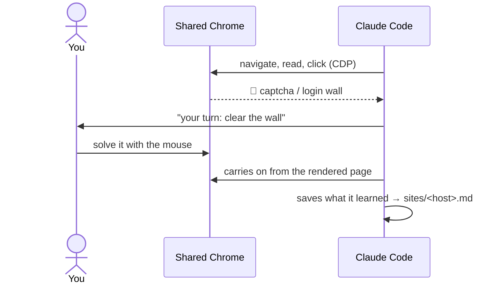

# tandem

[](https://github.com/bgmacris/quimera-ai/actions/workflows/ci.yml)


**One Chrome window, two drivers.** You and Claude Code share a real browser in real time: you clear
the captcha, the 2FA login, the client certificate — Claude picks up from the page you left and does
the rest. And it remembers how each site is navigated, in markdown you can read and edit.



## Why tandem

- 🤝 **The handoff is the point.** Only a human can clear some walls (anti-bot checkpoints, 2FA,
  AutoFirma, client certificates). With tandem you clear them in the same window the agent works in —
  no cookie copying, no restarting the session.
- 🖥️ **The same Chrome you see and touch.** Local, headed, a dedicated profile, native to the
  terminal. Claude operates it over CDP via the [Playwright MCP](https://github.com/microsoft/playwright-mcp):
  rendered DOM, JS, snapshots, network.
- 🗺️ **Site memory you co-curate.** `tandem:map` keeps a per-site profile — routes, durable locators,
  recipes, gotchas — as plain markdown. It loads itself the next time you visit, so Claude starts from
  what was learned instead of re-deriving the page.

## Install

```
/plugin marketplace add bgmacris/quimera-ai
/plugin install tandem@quimera-ai
```

Needs Google Chrome or Chromium, Node 22+ and Claude Code v2.1.120+. Using Cursor or OpenCode? See
[`README.adapters.md`](README.adapters.md).

## Two-minute tour

On `books.toscrape.com` (a public scraping sandbox, no login), reproducing the profile shipped in
[`examples/`](examples/books.toscrape.com.md):

1. **`/tandem:browser-start`** — the shared window opens.
2. Ask Claude, in plain words:
   > "Navigate to books.toscrape.com and recon it: the route skeleton, the locator for a book pod,
   > and how pagination works. Then propose a `tandem:map` profile."

   Claude explores, drafts the profile, **you confirm**, and it lands in
   `~/.claude/tandem/sites/books.toscrape.com.md`.
3. Next visit, the profile **auto-injects**: Claude extracts all 20 book pods by durable `sel:` without
   re-reading the page first.
4. **`/tandem:browser-stop`**.

If a site puts up a captcha or a login on the way, you clear it with the mouse and Claude continues
from the already-rendered page.

## What you get

| | |
|---|---|
| `/tandem:browser-start` · `browser-status` · `browser-stop` | Shared Chrome lifecycle (idempotent; CDP is the source of truth) |
| `/tandem:cookies` | Export cookies over CDP, HttpOnly/Secure included — table, JSON, curl, headers, Netscape |
| `/tandem:intercept` | Background sniffer across all tabs: request **and** response bodies |
| `/tandem:pdf` | The tab you're looking at as PDF or full-page PNG; a PDF tab is saved as the original document |
| skill `tandem` | How Claude operates the shared browser and hands walls to you |
| skill `tandem:map` | Per-site navigation memory (recon → draft → you confirm → saved) |
| agent `web-navigator` | Heavy extraction in its own context, so DOM noise stays out of yours |

## Site memory: `tandem:map`

A profile lives at `~/.claude/tandem/sites/<host>.md`, outside git, and holds:

- **Route skeleton and durable locators**, anchored by role + name from the accessibility tree — not by
  ephemeral refs or position — with several anchors each.
- **Recipes and gotchas**, every line dated and tagged `[verified]` or `[hypothesis]`.
- **Executable recipes** (procedural memory): a named, parameterized task (`open-ticket-by-id
  TCK-2026-123`) compiles to observable steps (`--step`) or to a single Playwright call (`--fast`).
- **Executable locators (`sel:`)**: Claude clicks or types by durable selector
  (`role=button[name="…"]`) without first reading a snapshot to find the element — only when the
  route's fingerprint says `match`. *Maintained, frozen: no new features until a measurement shows they
  raise success.*
- **Drift by signal, not by date**: a fingerprint of the page's *skeleton* (not its data) says when
  the structure changed, so only what's affected gets re-validated.

Two hooks keep it honest:

- **Auto-injection** (`PostToolUse`): navigating to a host with a profile injects it into Claude's
  context as data — once per session, silent if there's none.
- **Writes need you** (`PreToolUse`): profiles are drafted from web pages, which can carry injected
  instructions, and they reach every later session. So the hook asks before anything writes
  `sites/*.md` — Write/Edit by path, the MCP's own `filename`, and Bash heuristically. Defense in depth,
  not a sandbox: other MCP servers' file tools and `*.fingerprints.json` (never injected; tampering only
  fakes drift/match) are not covered. In bypass-permissions mode the write goes through with a notice;
  `TANDEM_PROFILE_GATE=strict` denies it.

Design and research: [`docs/01-navigation-memory.md`](docs/01-navigation-memory.md).

## Measured, not promised

tandem is a **human-in-the-loop browser with site memory**. It is no longer sold as a context saver,
because we measured that.

**WebArena-Verified mini-pilot (2026-10-21)** — Magento admin, 3 task templates × 4 instances, Sonnet,
@playwright/mcp 0.0.83:

| Arm | Success | Page read per task (warm profile) | Cost per task |
|---|---|---|---|
| A · snapshot | 12/12 | 10–24 KB | — |
| B · `browser_find` | 12/12 | 10–24 KB | **0.060 $** |
| C · + site profile | 12/12 | **2.3–3.6 KB** | 0.072 $ |
| D · + recipes | 12/12 | **2.3–3.6 KB** | 0.076 $ |

- With a warm profile the agent **read 4–7× less of the page** — and it did **not** make tasks cheaper.
  Fixed overhead (system prompt, turns) dominates; C/D only broke even with B from the third instance.
- The templates were too easy to separate the arms by success. One site, one run per cell, varying
  machine load: an indication, not a law.
- Why the old gap closed: since 0.0.78 the MCP distills its snapshots and adds `browser_find`. On that
  admin a snapshot was ~5 KB (one measured task), not the ~105 KB measured on 0.0.76. Historical
  numbers (0.0.76, bytes only: profile vs snapshot ~16–30× smaller) are kept in
  [`docs/01`](docs/01-navigation-memory.md) for the record, not as a current claim.

**Open question:** does site memory raise *success* on hard sites (long navigation, ambiguous pages)?
That needs a pilot with templates where the plain arms fail.

> **Prior art.** None of the pieces is new: cross-session site memory (e.g. WebCoach), semantic
> locators by role + name, and human handoff for captcha/login (AuthRelay, Cloudflare Browser Run,
> BrowserAct) all exist. tandem's difference is **where it lives** — local, on the real Chrome you see,
> native to Claude Code, with memory as markdown you edit and commit instead of an opaque store or a
> cloud SaaS — plus structural drift detection and executable locators gated by a fingerprint.

## Security

- **Dedicated** profile at `${TANDEM_DATA_DIR}/chrome-profile` — never your personal Chrome.
- CDP on **loopback** (`127.0.0.1`) without auth: any local process can drive the browser while it's
  alive. Keep it short-lived; `/tandem:browser-stop` and `SessionEnd` close it.
- The profile accumulates cookies and tokens from your logins: treat it as a secret, out of git and
  backups.
- `tandem:map` profiles store **structure** (routes, locators), never sensitive data, and live outside
  git by default.
- `browser_evaluate` / `browser_run_code_unsafe` run arbitrary JS on the page: for analysis, not for
  destructive actions or exfiltration.

## Configuration

<details>
<summary>Environment variables</summary>

| Variable | Default | Purpose |
|---|---|---|
| `TANDEM_CHROME_BIN` | autodetect (macOS/Linux) | path to the Chrome/Chromium binary |
| `TANDEM_AUTOSTART` | on (off under WSL) | `1`/`0`: start tandem's Chrome automatically on the first `browser_*` call. Off by default under WSL, where the browser is often an external Windows Chrome |
| `TANDEM_MCP_ARGS` | — | extra `@playwright/mcp` flags, appended last so they override tandem's defaults (`--output-max-size 52428800 --timeout-action 10000`), e.g. `--image-responses omit` |
| `TANDEM_CHROME_ARGS` | — | extra Chrome flags (e.g. `--headless=new` for unattended runs/CI) |
| `TANDEM_CDP_PORT`   | `9222` | CDP port on loopback. Wins over the port saved by the last start (`cdp-port`); set it where Claude Code gets its env (shell or settings `env`) so the MCP, commands and hooks all see it |
| `TANDEM_DATA_DIR`   | `~/.claude/tandem` | Chrome profile, logs, and site profiles |
| `TANDEM_CDP_WAIT`   | `15` | seconds `start` waits for Chrome's CDP (raise it on a slow or loaded machine) |
| `TANDEM_PROFILE_GATE` | — | `strict`: in bypass-permissions mode, DENY site-profile writes instead of allowing them with a notice (default/auto mode always ask) |
| `TANDEM_SANDBOX_GUARD` | on | `0`: don't deny the browser calls that hang on pages that cannot run scripts (see Troubleshooting) |
| `TANDEM_FOCUS_EMULATION` | on | `0`: don't keep the agent's tab painting while its tools run (see Troubleshooting) |
| `TANDEM_TAB_DRIFT` | on | `0`: don't warn the agent when its tab moved without it asking (see Troubleshooting) |
| `TANDEM_PDF_CAPTURE` | on | `0`: don't save the PDFs that reach the agent's tab (see Troubleshooting) |
| `TANDEM_DEBUG` | off | `1`: the launcher logs what it does on the agent's tab (focus emulation, PDF capture) to the MCP's stderr |
| `TANDEM_FOCUS_LINGER_MS` | `15000` | how long the agent's tab keeps painting after its last tool call |
| `TANDEM_BROWSER`    | — | `external`: tandem only talks to the CDP port (e.g. Windows Chrome from WSL); start/stop via `TANDEM_BROWSER_START_CMD` / `_STOP_CMD` |

</details>

## Platforms

| | |
|---|---|
| **macOS** | Supported and tested (CI + manual). |
| **Linux** | Supported. Engine tests, shellcheck and a real headless-Chrome e2e (daemon, recorder, intercept over several tabs, cookies, pdf, external mode) run in CI. |
| **Windows native** | The MCP launcher is node, and the engine + MCP handshake run in CI on `windows-latest`. The browser lifecycle (`lib.sh`, Git Bash) is **best effort**: Chrome is autodetected under Program Files / LocalAppData, but start/stop is not verified. Reliable option: start Chrome yourself and use external browser mode. |
| **WSL2** | Behaves as Linux. If the browser is the **Windows** Chrome over mirrored networking, use external browser mode — tandem's own start would open a Linux Chrome (that's why autostart is off under WSL). |

**External browser mode** — `TANDEM_BROWSER=external`: tandem never launches or kills a browser, it
only talks to the CDP port. `browser-start` checks that something answers, `browser-stop` and
`SessionEnd` leave it alone, `status` says `mode: external`. To delegate the lifecycle (e.g. a script
that starts the Windows Chrome with its certificates), set `TANDEM_BROWSER_START_CMD` /
`TANDEM_BROWSER_STOP_CMD` (run with `sh -c`); with a start command, autostart uses it.

## Troubleshooting

<details>
<summary><code>ECONNREFUSED 127.0.0.1:9222</code></summary>

No Chrome is running → `/tandem:browser-start`.
</details>

<details>
<summary><code>File access denied … outside allowed roots</code> when passing <code>filename</code></summary>

@playwright/mcp only writes files under the output dir (`~/.claude/tandem/output/`) or the MCP's
workspace root. Use an absolute path inside the output dir, or omit `filename`.
</details>

<details>
<summary><code>tandem: the current page (…) cannot run scripts</code></summary>

The page is served with CSP `sandbox` (every `raw.githubusercontent.com` file is), and on it
@playwright/mcp 0.0.83 never returns from `browser_evaluate`, `browser_click` & co. — its post-action
wait is a timer inside the page ([microsoft/playwright#43752](https://github.com/microsoft/playwright/issues/43752)).
tandem denies those calls instead of hanging. Read such a page by `fetch()`ing it from
`browser_evaluate` on a normal page (`browser_snapshot` flattens the text and cuts it short).
`TANDEM_SANDBOX_GUARD=0` turns the guard off.
</details>

<details>
<summary>A click on a background tab, a covered or a minimized window timed out (before 0.9.5)</summary>

@playwright/mcp connects without focus emulation, so Chrome stops painting a page it thinks nobody
sees, and the click's "stable" check waits for frames that never come. tandem's MCP launcher switches
focus emulation on for the agent's current tab while its tools run, and off 15 s after the last one (an
animated page keeps costing CPU only that long). The page sees `visibilitychange` around those
windows. `TANDEM_FOCUS_EMULATION=0` turns it off.
</details>

<details>
<summary>You clicked in the window while the agent was reading a page</summary>

Nobody owns a tab, so your click moves the page the agent works on. Since 0.9.6 the agent is told: when
a browser call that only reads finds the tab on another URL than at its previous call, a hook warns it
that what it read before belongs to the old page. Changes within 15 s of the agent's own click or
navigation are taken as its effects (a redirect) and not reported. `TANDEM_TAB_DRIFT=0` turns the
warning off.
</details>

<details>
<summary>The agent sees nothing of a PDF tab</summary>

Chrome's PDF viewer is outside the DOM and the accessibility tree. Since 0.9.7 a PDF that reaches the
agent's tab while its tools run — a link, a form POST, a download — is saved to
`~/.claude/tandem/output/pdf/` as it arrives, and the tool's result says where; the agent reads the
file. You see the PDF in the viewer as always. Iframes, `<embed>`/`<object>` and `blob:` PDFs the page
makes are covered too. Not covered: what arrives outside the agent's tools' run + 15 s — for an open PDF
tab, `tandem-pdf --url <url>` (or `/tandem:pdf`) saves it from Chrome's cache. `TANDEM_PDF_CAPTURE=0`
turns the capture off. Before 0.9.7, `tandem-pdf` on a PDF tab printed the viewer's frame, not the
document.
</details>

## How it's built

```
Chrome (headed, dedicated profile, --remote-debugging-port on 127.0.0.1)
   ▲ mouse (human)                ▲ CDP (Claude)
   └── visible window             └── npx @playwright/mcp --cdp-endpoint → browser_* tools
```

- **`scripts/chrome-daemon.sh`** `{start|stop|restart|status}` — Chrome lifecycle, idempotent,
  based on the CDP healthcheck (the source of truth for state is CDP, not the PID).
- **`scripts/mcp-launch.mjs`** — the `.mcp.json` command (`mcp-launch.sh` is a wrapper kept for the
  adapters); launches the Playwright MCP lazily (it doesn't start Chrome, so `initialize` never blocks)
  behind a transparent stdio proxy that keeps the agent's tab painting while its tools run
  (`scripts/focus-emulation.mjs`).
- **`scripts/map.sh`**, **`fingerprint.mjs`**, **`page-signals.mjs`**, **`selector.mjs`**,
  **`recipe.mjs`**, **`hook-inject-profile.mjs`** — the `tandem:map` engine (profile store, page
  fingerprint, drift, executable selectors, recipes, auto-injection). `page-signals.mjs print` emits the
  canonical evaluate; `selector.mjs` generates the `sel:` values; `recipe.mjs compile` compiles recipes
  to Playwright (`--fast`) or steps (`--step`).
- **`skills/`** — `tandem` (operating the shared browser) and `map` (site memory).
- **`agents/web-navigator.md`** — subagent for heavy extraction without polluting the main context.

### Development

Two checks before publishing or after touching the shell/JS (neither starts Chrome):

```
tests/smoke.sh                                         # tandem:map engine + regression guards
shellcheck -x -S style scripts/*.sh bin/* tests/*.sh   # shell lint (brew install shellcheck)
```

`smoke.sh` isolates state in a temporary `TANDEM_DATA_DIR` and verifies: parsing of all scripts, the
`+x` bit on the invocables, `map.sh` (including `index` with valid JSON even when the frontmatter has
quotes), `fingerprint` (capture/check/drift and **rejection of a host with traversal**), and the
injection hook (silent without a profile · once-per-session · cleanup).

CI ([`.github/workflows/ci.yml`](../../.github/workflows/ci.yml)) on every push/PR: `smoke.sh` + MCP
handshake on `ubuntu-latest` (Node 22/24/26) and `macos-latest`; engine tests + handshake on
`windows-latest`; a headless-Chrome e2e on `ubuntu-latest`; shellcheck and adapter parsing. A headed
start/stop needs a display and is tested by hand: `/tandem:browser-start` → `/tandem:browser-status` →
`/tandem:browser-stop`.
